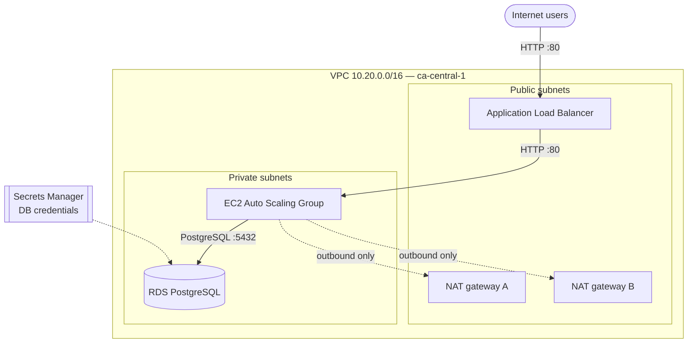

# AWS DevOps Project — CDK Infrastructure

Infrastructure as Code for a highly available web application on AWS, written with the **AWS CDK v2 (TypeScript)** and deployed as an AWS CloudFormation stack in **ca-central-1 (Canada Central)**.

The stack creates:

- a **VPC** across two Availability Zones, with public and private subnets and one NAT gateway per AZ
- **security groups** that chain Internet → ALB → EC2 → database
- **EC2 compute**: a Launch Template and an Auto Scaling Group with CPU target tracking
- an **Application Load Balancer** (ALB) with an HTTP listener and a health-checked target group
- an **Amazon RDS for PostgreSQL** database, with credentials stored in **AWS Secrets Manager**

Because CloudFormation deployments are declarative, re-deploying unchanged code makes no changes. Deployments are deterministic and idempotent.

---

## Table of contents

- [Architecture](#architecture)
- [Project structure](#project-structure)
- [Prerequisites](#prerequisites)
- [Installation](#installation)
- [Configuration](#configuration)
- [Deployment](#deployment)
- [Post-deployment verification](#post-deployment-verification)
- [Stack outputs](#stack-outputs)
- [Rollback procedures](#rollback-procedures)
- [CI/CD with GitHub Actions](#cicd-with-github-actions)
- [Cost and cleanup](#cost-and-cleanup)
- [Troubleshooting](#troubleshooting)

---

## Architecture



### Network

| Subnet           | AZ            | CIDR         | Purpose            |
| ---------------- | ------------- | ------------ | ------------------ |
| public-subnet-a  | ca-central-1a | 10.20.1.0/24 | ALB, NAT gateway A |
| private-subnet-a | ca-central-1a | 10.20.2.0/24 | EC2 instances, RDS |
| public-subnet-b  | ca-central-1b | 10.20.3.0/24 | ALB, NAT gateway B |
| private-subnet-b | ca-central-1b | 10.20.4.0/24 | EC2 instances, RDS |

- Public subnets route `0.0.0.0/0` to the internet gateway.
- Each private subnet routes `0.0.0.0/0` to the NAT gateway **in its own AZ**, so one AZ failing doesn't cut internet access for the other.

### Security groups

| Security group | Inbound                                                   | Outbound |
| -------------- | --------------------------------------------------------- | -------- |
| ALB            | TCP 80 and 443 from `0.0.0.0/0`                         | All      |
| EC2            | TCP 80 and 443 **from the ALB security group only** | All      |
| Database       | TCP 5432 **from the EC2 security group only**       | All      |

EC2 instances and the database are never reachable directly from the internet.

### Compute, load balancing and database

- **Auto Scaling Group** in the private subnets, launched from an Amazon Linux 2023 Launch Template. A target tracking policy keeps average CPU at **50%**.
- **ALB** (internet-facing) with an HTTP listener on port 80 that forwards to a target group. The health check is `GET /health` every 30 s: 3 successes mark a target healthy, 3 failures mark it unhealthy.
- **RDS PostgreSQL** in a DB subnet group made of the private subnets. The username is `dbuser`, and the password is generated in Secrets Manager.

---

## Project structure

```text
.
├── bin/
│   └── aws-devops-project.ts        # CDK app entry point (account, region)
├── lib/
│   ├── aws-devops-project-stack.ts  # Main stack: assembles all constructs
│   ├── network.ts                   # VPC, IGW, subnets, NAT gateways, route tables
│   ├── security-groups.ts           # ALB, EC2 and database security groups
│   ├── compute.ts                   # Launch Template, Auto Scaling Group, scaling policy
│   ├── alb.ts                       # Application Load Balancer, target group, listener
│   └── database.ts                  # Secrets Manager secret, DB subnet group, RDS
├── .github/workflows/
│   └── cdk.yml                      # GitHub Actions: deploy / destroy
├── cdk.json
├── package.json
└── tsconfig.json
```

---

## Prerequisites

| Tool                 | Check                           | Notes                                                                   |
| -------------------- | ------------------------------- | ----------------------------------------------------------------------- |
| AWS CLI v2           | `aws --version`               | Configure credentials with `aws configure`                            |
| Node.js (active LTS) | `node --version`              |                                                                         |
| AWS CDK v2           | `npx cdk --version`           | Installed as a project dependency (see below)                           |
| IAM permissions      | `aws sts get-caller-identity` | The identity must be able to bootstrap and deploy CloudFormation stacks |

> **Use the project's CDK CLI (`npx cdk`).** The CDK CLI must be able to read the *cloud assembly schema* written by `aws-cdk-lib`. A globally installed `cdk` can have a different version than the one in `package.json`, which causes the error *"Cloud assembly schema version mismatch"*. Running every command through `npx cdk` uses the version pinned in the project.

---

## Installation

```bash
git clone https://github.com/<your-user>/<your-repo>.git
cd <your-repo>
npm ci            # or: npm install
npm run build     # compile TypeScript
```

### Bootstrap (once per account and Region)

Bootstrapping creates the `CDKToolkit` stack, which stores deployment assets:

```bash
npx cdk bootstrap aws://ACCOUNT_ID/ca-central-1
```

Replace `ACCOUNT_ID` with the 12-digit account ID returned by `aws sts get-caller-identity`.

---

## Configuration

The account and Region are set in `bin/aws-devops-project.ts`:

```typescript
new AwsDevopsProjectStack(app, 'AwsDevopsProjectStack', {
  env: { account: 'ACCOUNT_ID', region: 'ca-central-1' },
});
```

Some values can be overridden with **CDK context** (`-c key=value`) without changing the code:

| Context key         | Default      | Description                     |
| ------------------- | ------------ | ------------------------------- |
| `asgMin`          | `1`        | Minimum number of EC2 instances |
| `asgMax`          | `4`        | Maximum number of EC2 instances |
| `asgDesired`      | `2`        | Desired number of EC2 instances |
| `ec2InstanceType` | `t3.micro` | EC2 instance type               |
| `storageSize`     | `20`       | RDS allocated storage (GB)      |

Example:

```bash
npx cdk deploy -c asgDesired=3 -c ec2InstanceType=t3.small -c storageSize=50
```

> **Note:** the AMI ID in the Launch Template is specific to `ca-central-1`. To deploy in another Region, update the AMI ID.

---

## Deployment

### 1. Validate (synthesize)

Compile the CDK code and report configuration errors before anything is deployed:

```bash
npx cdk synth
```

### 2. Review changes (idempotency check)

Compare the local code with the stack currently deployed:

```bash
npx cdk diff
```

- **No differences:** the deployed stack already matches the code. Re-running the deployment is safe and changes nothing.
- **Differences shown:** review them before deploying. Pay attention to resources marked for **replacement** (especially the RDS instance), and to IAM or security group changes.

On a first deployment, `cdk diff` lists every resource as new. This is expected.

### 3. Deploy

```bash
npx cdk deploy
```

When the deployment adds IAM or security group changes, the CDK asks for confirmation. If the app has more than one stack, use `npx cdk deploy --all` or name the stack.

---

## Post-deployment verification

Confirm the stack status is `CREATE_COMPLETE` or `UPDATE_COMPLETE` in the CloudFormation console:

```bash
aws cloudformation describe-stacks --stack-name AwsDevopsProjectStack \
  --query "Stacks[0].StackStatus" --output text
```

Then check each component:

- [ ] **VPC:** subnets, route tables and NAT gateways
- [ ] **EC2:** Launch Template, and Auto Scaling Group with the desired number of instances running
- [ ] **Load balancer:** ALB, listener and target group, with targets reporting **healthy**
- [ ] **RDS:** PostgreSQL status is **Available**, in the private subnets
- [ ] **Secrets Manager:** the database credentials secret exists
- [ ] **Application:** the ALB DNS name responds:

```bash
curl http://<ALB-DNS-name>
curl http://<ALB-DNS-name>/health
```

> Targets stay **unhealthy** until the instances run a web server that answers `/health` with HTTP 200.

---

## Stack outputs

The stack exposes:

- the Application Load Balancer DNS name
- the RDS endpoint
- the Secrets Manager secret ARN

They appear at the end of `cdk deploy` and in the CloudFormation console under **Outputs**. From the command line:

```bash
aws cloudformation describe-stacks --stack-name AwsDevopsProjectStack \
  --query "Stacks[0].Outputs" --output table
```

To read the database credentials:

```bash
aws secretsmanager get-secret-value --secret-id <secret-ARN> \
  --query SecretString --output text
```

---

## Rollback procedures

### Automatic rollback

If a stack update fails, CloudFormation automatically rolls the stack back to its last stable state. No action is needed. Check the stack's **Events** tab to find the cause before re-deploying.

### Manual rollback

If a successful deployment introduces a problem:

```bash
git revert <commit>   # 1. return the code to the last working version
npx cdk diff          # 2. review the changes
npx cdk deploy        # 3. redeploy
```

### Stuck rollback (`UPDATE_ROLLBACK_FAILED`)

1. Open the CloudFormation console and select the stack.
2. On the **Events** tab, find the resource that could not be rolled back and fix the cause (for example, a resource changed or deleted outside CloudFormation, or missing permissions).
3. Choose **Stack actions → Continue update rollback**. A resource that can't be fixed can be selected under **Resources to skip**. The CLI equivalent:

   ```bash
   aws cloudformation continue-update-rollback --stack-name AwsDevopsProjectStack
   ```
4. When the stack reaches `UPDATE_ROLLBACK_COMPLETE`, redeploy with `npx cdk deploy`.

### Full stack removal (last resort)

```bash
npx cdk destroy
```

This deletes **all** resources in the stack, including the database.

---

## CI/CD with GitHub Actions

The workflow `.github/workflows/cdk.yml` deploys and destroys the stack:

| Trigger                                                                                         | Action  |
| ----------------------------------------------------------------------------------------------- | ------- |
| Push to `main`                                                                                | Deploy  |
| **Actions** tab → **Run workflow** → `deploy`                                   | Deploy  |
| **Actions** tab → **Run workflow** → `destroy`, and type `DESTROY` to confirm | Destroy |

Steps: checkout → `npm ci` → show CDK versions → sign in to AWS (OIDC) → build → bootstrap if needed → `cdk synth` / `diff` / `deploy`, or `cdk destroy` and a deletion check.

### Required repository secrets

Set these under **Settings → Secrets and variables → Actions**:

| Secret             | Example                                               | Description                                       |
| ------------------ | ----------------------------------------------------- | ------------------------------------------------- |
| `AWS_ROLE_ARN`   | `arn:aws:iam::ACCOUNT_ID:role/GitHubActionsCdkRole` | IAM role that GitHub Actions assumes through OIDC |
| `AWS_REGION`     | `ca-central-1`                                      | Target Region                                     |
| `AWS_ACCOUNT_ID` | `123456789012`                                      | Account used for bootstrap                        |

The workflow uses **OpenID Connect (OIDC)**, so no long-lived access keys are stored in GitHub. The IAM role must trust `token.actions.githubusercontent.com` for this repository, and must be allowed to assume the CDK bootstrap roles (`cdk-*`) and call `cloudformation:DescribeStacks`.

---

## Cost and cleanup

Some resources are billed **every hour while the stack exists**, even with no traffic:

- 2 NAT gateways
- the RDS instance
- the Application Load Balancer
- the EC2 instances

For a dev or test environment, destroy the stack when you're not using it (`npx cdk destroy` or the `destroy` workflow).

---

## Troubleshooting

| Problem                                             | Cause and fix                                                                                                                                                                                   |
| --------------------------------------------------- | ----------------------------------------------------------------------------------------------------------------------------------------------------------------------------------------------- |
| `Cloud assembly schema version mismatch`          | The CDK CLI is older than `aws-cdk-lib`. Pin compatible versions of `aws-cdk` and `aws-cdk-lib` in `package.json`, regenerate `package-lock.json`, and run commands with `npx cdk`. |
| Targets in the target group are **unhealthy** | Nothing answers `/health` on the instances, or the EC2 security group doesn't allow the ALB.                                                                                                  |
| `cdk destroy` fails on the database               | Deletion protection is on. Set `deletionProtection: false` and redeploy first.                                                                                                                |
| Stack in `UPDATE_ROLLBACK_FAILED`                 | See [Stuck rollback](#stuck-rollback-update_rollback_failed).                                                                                                                                    |
| Deployment fails with an IAM permission error       | The deploying identity needs permission for CloudFormation **and** for every resource the stack creates.                                                                                  |

---

## Tooling

- AWS CDK v2 (TypeScript), synthesized to AWS CloudFormation
- AWS CLI v2
- Node.js LTS
- GitHub Actions (OIDC authentication)
